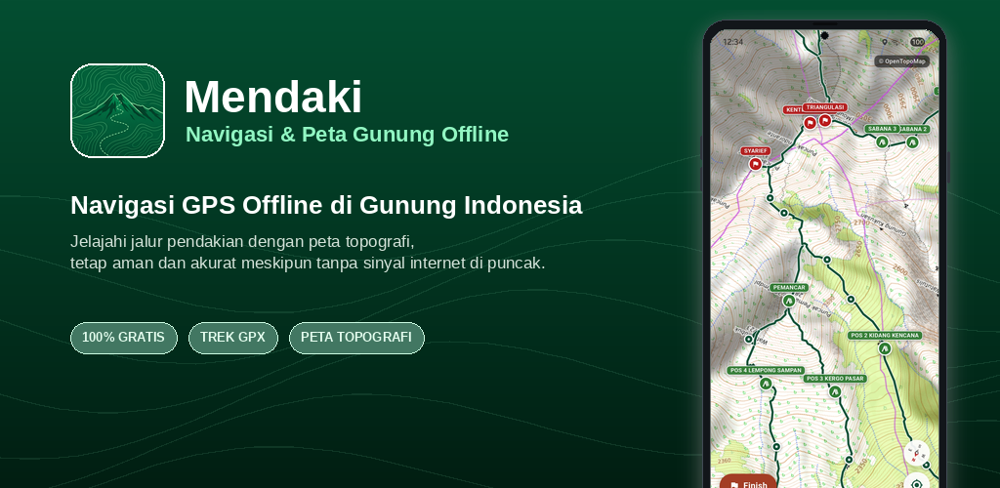

<p align="center">
  
</p>

<h1 align="center">
  Mendaki
</h1>
<p align="center">
   <b>Offline Mountain Navigation & Maps</b>
</p>
<p align="center">Explore hiking trails with offline maps, stay safe and accurate even without cellular signal on the summit. Built to help hikers navigate Indonesian mountains with full GPX trail support and local topographic map caching directly on your device.</p>

---

### 🚀 Getting Started

#### Prerequisites
- Flutter SDK (version 3.10.8 or higher)
- A [Supabase](https://supabase.com/) account (free tier works great)

#### 1. Clone the Repository
```bash
git clone https://github.com/<your-username>/mendaki.git
cd mendaki
```

#### 2. Install Dependencies
```bash
flutter pub get
```

#### 3. Configure Environment Variables (`.env`)
Copy the provided environment template `.env.example` to `.env`:
```bash
cp .env.example .env
```
Open `.env` and fill in your Supabase project credentials:
```env
SUPABASE_URL=https://your-project-id.supabase.co
SUPABASE_ANON_KEY=your-supabase-anon-key-here
GPX_BUCKET=gpx_bucket
```

#### 4. Setup Supabase Database & Storage
1. Open the **SQL Editor** in your Supabase dashboard.
2. Execute [`supabase/schema.sql`](supabase/schema.sql) to create the `mountain` and `route` tables, setup RLS policies, and populate initial dummy data.
3. In the Supabase dashboard, go to **Storage** and create a public bucket named match the bucket name configured in env `GPX_BUCKET`.

#### 5. Run the Application
Launch the app on your connected device or emulator:
```bash
flutter run
```

---

### 🤝 Contributing

Contributions are warmly welcome! Please check out our [Contributing Guide](CONTRIBUTING.md) for details on code style, branch conventions, and testing guidelines.

---

### 📄 License & Attributions

- **Application Code**: Licensed under the [PolyForm Noncommercial License 1.0.0](LICENSE.md) © 2026 Mendaki Contributors. Free to use, modify, and share for personal, educational, and noncommercial purposes. Commercial use or monetization is strictly prohibited without prior written permission.
- **GPX Data**: Mountain trail routes and waypoint data referenced from [Astacala](https://astacala.org).
- **Map Data**: © [OpenStreetMap contributors](https://www.openstreetmap.org/copyright), licensed under the [Open Database License (ODbL)](https://opendatacommons.org/licenses/odbl/).
- **Map Rendering & Topographic Tiles**: © [OpenTopoMap](https://opentopomap.org/), licensed under [CC-BY-SA 3.0](https://creativecommons.org/licenses/by-sa/3.0/).
